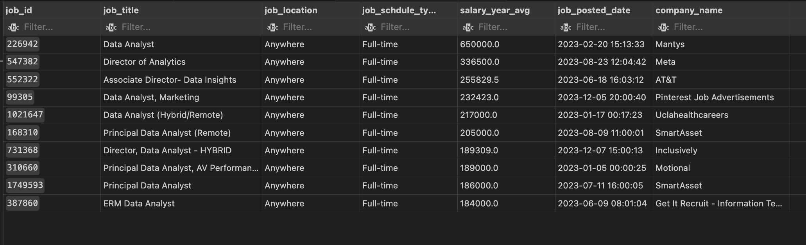
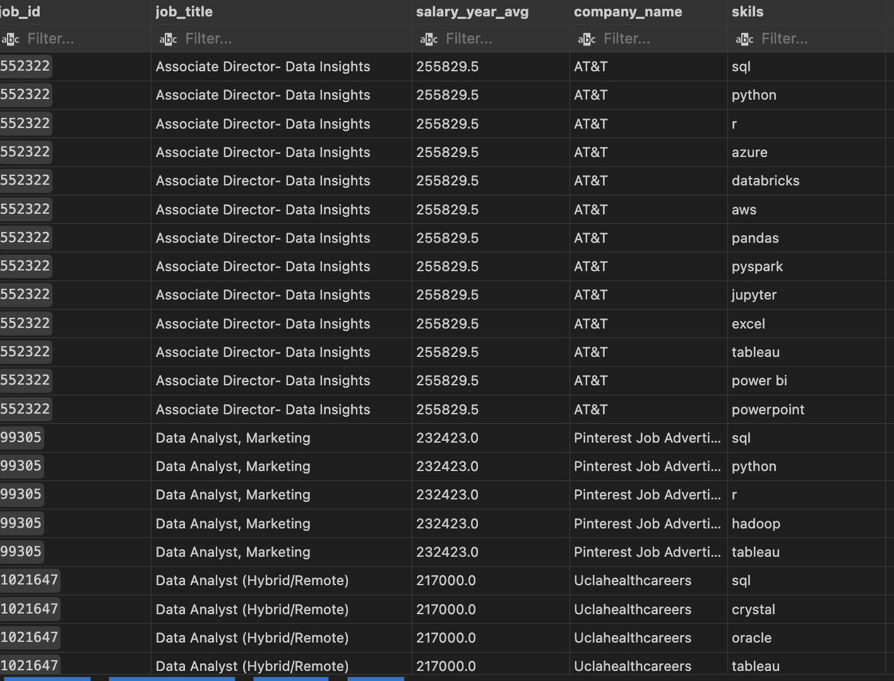
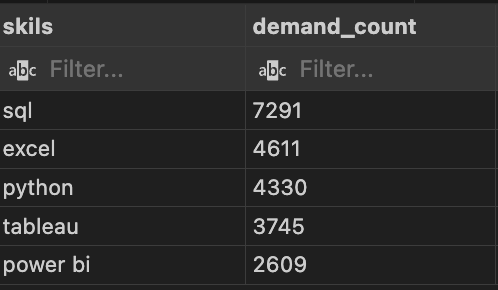
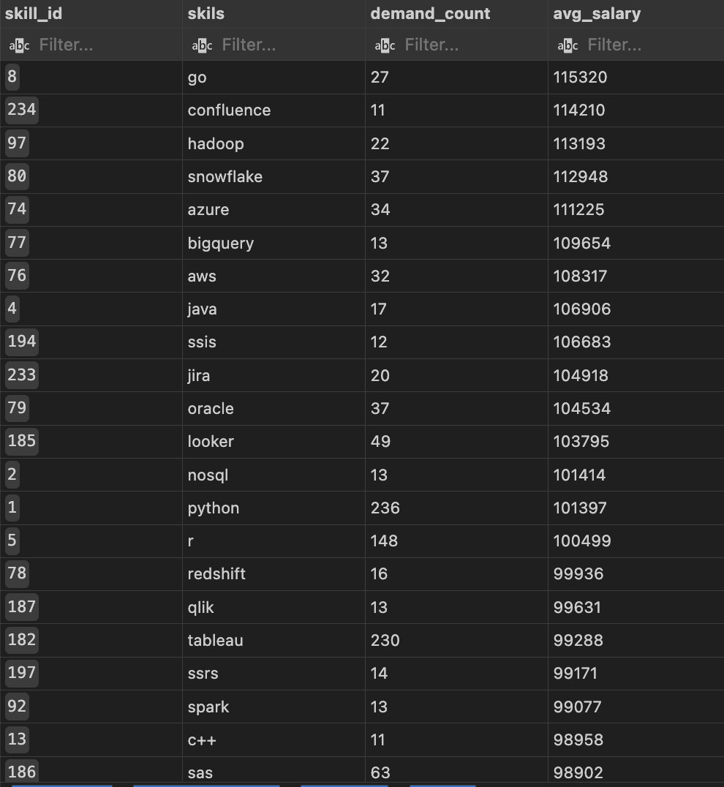

# Arbeitsmarktanalyse für Data Analysts mit PostgreSQL


Welche Data-Analyst-Jobs zahlen am besten – und welche Skills lohnen sich wirklich?
In diesem Projekt analysiere ich Stellenanzeigen aus dem Jahr 2023 mit PostgreSQL und leite daraus ab,
welche Fähigkeiten **sowohl stark nachgefragt als auch gut bezahlt** sind.

---

## Inhalt

- [Fragestellungen](#fragestellungen)
- [Datenmodell](#datenmodell)
- [Projektstruktur](#projektstruktur)
- [Analyse & Ergebnisse](#analyse--ergebnisse)
- [Fazit](#fazit)
- [Eingesetzte SQL-Techniken](#eingesetzte-sql-techniken)

---

## Fragestellungen

1. Welche Data-Analyst-Jobs (remote) sind am besten bezahlt?
2. Welche Skills verlangen diese Top-Jobs?
3. Welche Skills werden insgesamt am häufigsten nachgefragt?
4. Welche Skills sind mit den höchsten Gehältern verbunden?
5. Welche Skills sind **optimal zu lernen** – hohe Nachfrage *und* hohes Gehalt?

## Datenmodell

Die Daten sind als **Sternschema** aufgebaut:

```
                 ┌──────────────┐
                 │ company_dim  │
                 └──────┬───────┘
                        │ company_id
┌──────────────┐  ┌─────┴─────────────┐  ┌──────────────┐
│  skills_dim  ├──┤  skills_job_dim   ├──┤ job_postings │
│              │  │ (Brückentabelle)  │  │    _fact     │
└──────────────┘  └───────────────────┘  └──────────────┘
```

| Tabelle | Inhalt |
|---|---|
| `job_postings_fact` | Stellenanzeigen mit Titel, Ort, Remote-Option, Gehalt, Datum |
| `company_dim` | Arbeitgeber |
| `skills_dim` | Skills und Skill-Kategorie |
| `skills_job_dim` | Verknüpfung Stellenanzeige ↔ Skill (n:m) |

## Projektstruktur

```
├── create_tables/   Tabellen, Indizes, Laden der CSV-Daten, Monatstabellen
├── beginner/        Grundlagen: SELECT, Filter, JOINs, Aggregation, NULL-Werte
├── advanced/        CTEs, Subqueries, CASE, UNION, Datumsfunktionen, DDL/DML
└── assets/          Visualisierungen der Ergebnisse
```

---

## Analyse & Ergebnisse

### 1. Bestbezahlte Data-Analyst-Jobs (remote)

Gefiltert auf Data-Analyst-Rollen mit Remote-Option und angegebenem Jahresgehalt, sortiert nach Gehalt.

<details>
<summary>SQL anzeigen</summary>

```sql
SELECT
    job_id,
    job_title,
    job_location,
    job_schedule_type,
    salary_year_avg,
    job_posted_date,
    name AS company_name
FROM job_postings_fact
LEFT JOIN company_dim ON job_postings_fact.company_id = company_dim.company_id
WHERE job_title_short = 'Data Analyst'
  AND job_location = 'Anywhere'
  AND salary_year_avg IS NOT NULL
ORDER BY salary_year_avg DESC
LIMIT 10;
```
</details>

**Ergebnis**
- Die Top-10-Gehälter reichen von **184.000 $ bis 650.000 $** pro Jahr.
- Die Jobtitel sind sehr unterschiedlich – vom Data Analyst bis zur Leitung Analytics.
- Hohe Gehälter werden branchenübergreifend gezahlt.



### 2. Skills der bestbezahlten Jobs

Die Top-10-Jobs werden per CTE ermittelt und mit den Skill-Tabellen verknüpft.

<details>
<summary>SQL anzeigen</summary>

```sql
WITH top_paying_jobs AS (
    SELECT job_id, job_title, salary_year_avg, name AS company_name
    FROM job_postings_fact
    LEFT JOIN company_dim ON job_postings_fact.company_id = company_dim.company_id
    WHERE job_title_short = 'Data Analyst'
      AND job_location = 'Anywhere'
      AND salary_year_avg IS NOT NULL
    ORDER BY salary_year_avg DESC
    LIMIT 10
)
SELECT top_paying_jobs.*, skills
FROM top_paying_jobs
INNER JOIN skills_job_dim ON top_paying_jobs.job_id = skills_job_dim.job_id
INNER JOIN skills_dim     ON skills_job_dim.skill_id = skills_dim.skill_id
ORDER BY salary_year_avg DESC;
```
</details>

**Ergebnis**

| Skill | Nennungen in den Top-10-Jobs |
|---|---|
| SQL | 8 |
| Python | 7 |
| Tableau | 6 |

Weitere Skills: R, Snowflake, Pandas, Excel.



### 3. Die gefragtesten Skills

<details>
<summary>SQL anzeigen</summary>

```sql
SELECT
    skills,
    COUNT(skills_job_dim.job_id) AS demand_count
FROM job_postings_fact
INNER JOIN skills_job_dim ON job_postings_fact.job_id = skills_job_dim.job_id
INNER JOIN skills_dim     ON skills_job_dim.skill_id = skills_dim.skill_id
WHERE job_title_short = 'Data Analyst'
  AND job_work_from_home = TRUE
GROUP BY skills
ORDER BY demand_count DESC
LIMIT 5;
```
</details>

**Ergebnis**
- **SQL und Excel** bleiben die Basis – Datenverarbeitung und Tabellenkalkulation sind Pflicht.
- **Python, Tableau und Power BI** folgen – Programmierung und Visualisierung gewinnen an Bedeutung.



### 4. Optimale Skills: Nachfrage × Gehalt

Kombination aus Nachfrage (mehr als 10 Stellenanzeigen) und durchschnittlichem Gehalt.

<details>
<summary>SQL anzeigen</summary>

```sql
SELECT
    skills_dim.skill_id,
    skills_dim.skills,
    COUNT(skills_job_dim.job_id)                 AS demand_count,
    ROUND(AVG(job_postings_fact.salary_year_avg), 0) AS avg_salary
FROM job_postings_fact
INNER JOIN skills_job_dim ON job_postings_fact.job_id = skills_job_dim.job_id
INNER JOIN skills_dim     ON skills_job_dim.skill_id = skills_dim.skill_id
WHERE job_title_short = 'Data Analyst'
  AND salary_year_avg IS NOT NULL
  AND job_work_from_home = TRUE
GROUP BY skills_dim.skill_id
HAVING COUNT(skills_job_dim.job_id) > 10
ORDER BY avg_salary DESC, demand_count DESC
LIMIT 25;
```
</details>

**Ergebnis**

| Bereich | Beobachtung |
|---|---|
| Programmiersprachen | Python (Nachfrage 236, Ø ~101.400 $) und R (148, Ø ~100.500 $) – sehr gefragt, aber weit verbreitet |
| Cloud & Big Data | Snowflake, Azure, AWS und BigQuery – solide Nachfrage bei überdurchschnittlichen Gehältern |
| BI & Visualisierung | Tableau (230, Ø ~99.300 $) und Looker (49, Ø ~103.800 $) |
| Datenbanken | Oracle, SQL Server, NoSQL – Ø zwischen ~97.800 $ und ~104.500 $ |



---

## Fazit

1. **SQL ist der wichtigste Skill** – am häufigsten nachgefragt und in den bestbezahlten Jobs am stärksten vertreten.
2. **Python und ein BI-Tool** (Tableau oder Power BI) sind die logische Ergänzung.
3. **Cloud-Kenntnisse** (Azure, Snowflake, AWS) heben das Gehaltsniveau spürbar an.
4. Sehr spezialisierte Skills erzielen die höchsten Durchschnittsgehälter, sind aber selten gefragt.

## Eingesetzte SQL-Techniken

| Technik | Wo |
|---|---|
| `CREATE TABLE`, Primär- & Fremdschlüssel, Indizes | `create_tables/` |
| `JOIN`s (INNER / LEFT) über ein Sternschema | Analysen 1–4 |
| Aggregation mit `GROUP BY`, `HAVING`, `COUNT`, `AVG` | Analysen 3–4 |
| CTEs (`WITH`) und Subqueries | Analyse 2, `advanced/` |
| `CASE`, `UNION`, Datumsfunktionen | `advanced/` |

---

**Autor:** Sarwar Siyam Aghbar · [Portfolio](https://sarwar-siyam.github.io/ProWebsite/) · [LinkedIn](https://www.linkedin.com/in/siyam-aghbar-1a1a46248/)
